# Coding-agent memory research: citation-verified lineage (as of 2026-10-18)

Based on the Mermaid TD block in Vedant2100/concept-erasure-analysis/index.html. **Arrow A → B only if B explicitly references A.** This is a citation DAG, not evidence of direct method inheritance. Preprint = not independently verified accepted.

```mermaid
flowchart TD
    react["ReAct<br/>ICLR 2023"]
    reflex["Reflexion<br/>NeurIPS 2023"]
    voyager["Voyager<br/>Preprint 2023"]
    expel["ExpeL<br/>AAAI 2024"]
    swebench["SWE-bench<br/>ICLR 2024"]
    autocoderover["AutoCodeRover<br/>ISSTA 2024"]
    mem0["Mem0<br/>ECAI 2025"]
    ctim["CTIM-Rover<br/>REALM 2025 workshop"]
    agentkb["Agent KB<br/>Preprint 2025"]
    awm["Agent Workflow Memory<br/>ICML 2025"]
    synapse["Synapse<br/>ICLR 2024"]
    swecl["SWE-Bench-CL<br/>Preprint 2025"]
    sweexp["SWE-Exp<br/>Preprint 2025"]
    memr1["Memory-R1<br/>ACL 2026 Main"]
    reasoning["ReasoningBank<br/>ICLR 2026"]
    sedm["SEDM<br/>Preprint · 2026 rev."]
    swecontext["SWE-ContextBench<br/>Preprint 2026"]
    memcollab["MemCollab<br/>Preprint 2026"]
    mtl["Memory Transfer Learning<br/>EMNLP 2026 Main"]
    remember["Learning When to Remember<br/>Preprint 2026"]
    codeskill["CODESKILL<br/>Preprint 2026"]
    memop["MemOp<br/>Preprint 2026"]
    learnshare["Learning to Share<br/>ICML 2026"]
    org["Shared Organizational Memory<br/>Preprint 2026"]
    distill["Agent Memory Distillation<br/>EMNLP 2026 Findings"]
    memguard["MemGuard<br/>Preprint 2026"]
    retain["Learning What to Retain<br/>EMNLP 2026 Main"]
    vibe["VibeMemBench<br/>Preprint 2026"]
    jev["Jev-Mem<br/>Preprint 2026"]
    scope["Scope Before You Persist<br/>Preprint 2026"]
    aecg["AECG<br/>Preprint 2026"]
    chronos["Chronos<br/>Preprint 2026"]
    sepm["SEPM<br/>Preprint 2026"]
    reflex --> expel
    voyager --> expel
    swebench --> autocoderover
    reflex --> mem0
    react --> ctim
    reflex --> ctim
    expel --> ctim
    swebench --> ctim
    autocoderover --> ctim
    swebench --> swecl
    swebench --> agentkb
    expel --> sweexp
    swebench --> sweexp
    autocoderover --> sweexp
    mem0 --> memr1
    expel --> reasoning
    swebench --> reasoning
    sweexp --> reasoning
    mem0 --> reasoning
    reflex --> sedm
    mem0 --> sedm
    swebench --> swecontext
    mem0 --> swecontext
    memr1 --> memcollab
    reasoning --> memcollab
    reflex --> mtl
    swebench --> mtl
    sweexp --> mtl
    reasoning --> mtl
    agentkb --> mtl
    awm --> mtl
    synapse --> mtl
    memr1 --> remember
    reflex --> codeskill
    expel --> codeskill
    swebench --> codeskill
    mem0 --> codeskill
    sweexp --> codeskill
    reasoning --> codeskill
    swebench --> memop
    ctim --> memop
    swecl --> memop
    swebench --> org
    autocoderover --> org
    reflex --> distill
    expel --> distill
    reasoning --> distill
    mtl --> distill
    reflex --> memguard
    expel --> memguard
    swebench --> memguard
    reasoning --> memguard
    memr1 --> retain
    swebench --> vibe
    mem0 --> vibe
    swecl --> vibe
    reflex --> jev
    expel --> jev
    mem0 --> jev
    reflex --> scope
    reflex --> aecg
    expel --> aecg
    reflex --> chronos
    expel --> chronos
    swebench --> chronos
    autocoderover --> chronos
    sweexp --> chronos
    reflex --> sepm
    classDef foundation fill:#eef2ff,stroke:#4338ca,color:#172033,stroke-width:1.3px;
    classDef coding fill:#e0f2fe,stroke:#0369a1,color:#172033,stroke-width:1.3px;
    classDef benchmark fill:#dcfce7,stroke:#166534,color:#172033,stroke-width:1.3px;
    classDef general fill:#f5f3ff,stroke:#6d28d9,color:#172033,stroke-width:1.3px;
    classDef learned fill:#ffedd5,stroke:#9a3412,color:#172033,stroke-width:1.3px;
    classDef governance fill:#fce7f3,stroke:#9d174d,color:#172033,stroke-width:1.3px;
    classDef systems fill:#e2e8f0,stroke:#334155,color:#172033,stroke-width:1.3px;
    class react foundation;
    class reflex foundation;
    class voyager foundation;
    class expel foundation;
    class swebench benchmark;
    class autocoderover foundation;
    class mem0 general;
    class ctim coding;
    class agentkb coding;
    class awm general;
    class synapse general;
    class swecl benchmark;
    class sweexp coding;
    class memr1 learned;
    class reasoning coding;
    class sedm learned;
    class swecontext benchmark;
    class memcollab general;
    class mtl coding;
    class remember learned;
    class codeskill learned;
    class memop learned;
    class learnshare learned;
    class org systems;
    class distill general;
    class memguard governance;
    class retain learned;
    class vibe benchmark;
    class jev governance;
    class scope governance;
    class aecg governance;
    class chronos systems;
    class sepm systems;
```

## Edge ledger

Every pair was matched against the citing (child) paper's own bibliography. The exact bibliography title and the citing source URL are in `citation_edges.csv`.

- **Reflexion → ExpeL** — [child paper bibliography](https://ojs.aaai.org/index.php/AAAI/article/view/29936).
- **Voyager → ExpeL** — [child paper bibliography](https://ojs.aaai.org/index.php/AAAI/article/view/29936).
- **SWE-bench → AutoCodeRover** — [child paper bibliography](https://2024.issta.org/details/issta-2024-papers/127/AutoCodeRover-Autonomous-Program-Improvement).
- **Reflexion → Mem0** — [child paper bibliography](https://journals.sagepub.com/doi/10.3233/FAIA251160).
- **ReAct → CTIM-Rover** — [child paper bibliography](https://arxiv.org/html/2505.23422).
- **Reflexion → CTIM-Rover** — [child paper bibliography](https://arxiv.org/html/2505.23422).
- **ExpeL → CTIM-Rover** — [child paper bibliography](https://arxiv.org/html/2505.23422).
- **SWE-bench → CTIM-Rover** — [child paper bibliography](https://arxiv.org/html/2505.23422).
- **AutoCodeRover → CTIM-Rover** — [child paper bibliography](https://arxiv.org/html/2505.23422).
- **SWE-bench → SWE-Bench-CL** — [child paper bibliography](https://arxiv.org/html/2507.00014).
- **SWE-bench → Agent KB** — [child paper bibliography](https://arxiv.org/html/2507.06229).
- **ExpeL → SWE-Exp** — [child paper bibliography](https://arxiv.org/html/2507.23361).
- **SWE-bench → SWE-Exp** — [child paper bibliography](https://arxiv.org/html/2507.23361).
- **AutoCodeRover → SWE-Exp** — [child paper bibliography](https://arxiv.org/html/2507.23361).
- **Mem0 → Memory-R1** — [child paper bibliography](https://aclanthology.org/2026.acl-long.583/).
- **ExpeL → ReasoningBank** — [child paper bibliography](https://openreview.net/forum?id=jL7fwchScm).
- **SWE-bench → ReasoningBank** — [child paper bibliography](https://openreview.net/forum?id=jL7fwchScm).
- **SWE-Exp → ReasoningBank** — [child paper bibliography](https://openreview.net/forum?id=jL7fwchScm).
- **Mem0 → ReasoningBank** — [child paper bibliography](https://openreview.net/forum?id=jL7fwchScm).
- **Reflexion → SEDM** — [child paper bibliography](https://arxiv.org/html/2509.09498).
- **Mem0 → SEDM** — [child paper bibliography](https://arxiv.org/html/2509.09498).
- **SWE-bench → SWE-ContextBench** — [child paper bibliography](https://arxiv.org/html/2602.08316).
- **Mem0 → SWE-ContextBench** — [child paper bibliography](https://arxiv.org/html/2602.08316).
- **Memory-R1 → MemCollab** — [child paper bibliography](https://arxiv.org/html/2603.23234).
- **ReasoningBank → MemCollab** — [child paper bibliography](https://arxiv.org/html/2603.23234).
- **Reflexion → Memory Transfer Learning** — [child paper bibliography](https://arxiv.org/html/2604.14004).
- **SWE-bench → Memory Transfer Learning** — [child paper bibliography](https://arxiv.org/html/2604.14004).
- **SWE-Exp → Memory Transfer Learning** — [child paper bibliography](https://arxiv.org/html/2604.14004).
- **ReasoningBank → Memory Transfer Learning** — [child paper bibliography](https://arxiv.org/html/2604.14004).
- **Agent KB → Memory Transfer Learning** — [child paper bibliography](https://arxiv.org/html/2604.14004).
- **Agent Workflow Memory → Memory Transfer Learning** — [child paper bibliography](https://arxiv.org/html/2604.14004).
- **Synapse → Memory Transfer Learning** — [child paper bibliography](https://arxiv.org/html/2604.14004).
- **Memory-R1 → Learning When to Remember** — [child paper bibliography](https://arxiv.org/html/2604.27283).
- **Reflexion → CODESKILL** — [child paper bibliography](https://arxiv.org/html/2605.25430).
- **ExpeL → CODESKILL** — [child paper bibliography](https://arxiv.org/html/2605.25430).
- **SWE-bench → CODESKILL** — [child paper bibliography](https://arxiv.org/html/2605.25430).
- **Mem0 → CODESKILL** — [child paper bibliography](https://arxiv.org/html/2605.25430).
- **SWE-Exp → CODESKILL** — [child paper bibliography](https://arxiv.org/html/2605.25430).
- **ReasoningBank → CODESKILL** — [child paper bibliography](https://arxiv.org/html/2605.25430).
- **SWE-bench → MemOp** — [child paper bibliography](https://arxiv.org/html/2606.05646).
- **CTIM-Rover → MemOp** — [child paper bibliography](https://arxiv.org/html/2606.05646).
- **SWE-Bench-CL → MemOp** — [child paper bibliography](https://arxiv.org/html/2606.05646).
- **SWE-bench → Shared Organizational Memory** — [child paper bibliography](https://arxiv.org/html/2608.00122).
- **AutoCodeRover → Shared Organizational Memory** — [child paper bibliography](https://arxiv.org/html/2608.00122).
- **Reflexion → Agent Memory Distillation** — [child paper bibliography](https://arxiv.org/html/2608.07169).
- **ExpeL → Agent Memory Distillation** — [child paper bibliography](https://arxiv.org/html/2608.07169).
- **ReasoningBank → Agent Memory Distillation** — [child paper bibliography](https://arxiv.org/html/2608.07169).
- **Memory Transfer Learning → Agent Memory Distillation** — [child paper bibliography](https://arxiv.org/html/2608.07169).
- **Reflexion → MemGuard** — [child paper bibliography](https://arxiv.org/html/2608.21867).
- **ExpeL → MemGuard** — [child paper bibliography](https://arxiv.org/html/2608.21867).
- **SWE-bench → MemGuard** — [child paper bibliography](https://arxiv.org/html/2608.21867).
- **ReasoningBank → MemGuard** — [child paper bibliography](https://arxiv.org/html/2608.21867).
- **Memory-R1 → Learning What to Retain** — [child paper bibliography](https://arxiv.org/html/2609.00237).
- **SWE-bench → VibeMemBench** — [child paper bibliography](https://arxiv.org/html/2609.23570).
- **Mem0 → VibeMemBench** — [child paper bibliography](https://arxiv.org/html/2609.23570).
- **SWE-Bench-CL → VibeMemBench** — [child paper bibliography](https://arxiv.org/html/2609.23570).
- **Reflexion → Jev-Mem** — [child paper bibliography](https://arxiv.org/html/2609.23986).
- **ExpeL → Jev-Mem** — [child paper bibliography](https://arxiv.org/html/2609.23986).
- **Mem0 → Jev-Mem** — [child paper bibliography](https://arxiv.org/html/2609.23986).
- **Reflexion → Scope Before You Persist** — [child paper bibliography](https://arxiv.org/html/2609.29144).
- **Reflexion → AECG** — [child paper bibliography](https://arxiv.org/html/2610.05176).
- **ExpeL → AECG** — [child paper bibliography](https://arxiv.org/html/2610.05176).
- **Reflexion → Chronos** — [child paper bibliography](https://arxiv.org/html/2610.11578).
- **ExpeL → Chronos** — [child paper bibliography](https://arxiv.org/html/2610.11578).
- **SWE-bench → Chronos** — [child paper bibliography](https://arxiv.org/html/2610.11578).
- **AutoCodeRover → Chronos** — [child paper bibliography](https://arxiv.org/html/2610.11578).
- **SWE-Exp → Chronos** — [child paper bibliography](https://arxiv.org/html/2610.11578).
- **Reflexion → SEPM** — [child paper bibliography](https://arxiv.org/html/2610.14515).

## Scope note

This is a curated, traceable core of the research literature, not a claim to exhaust every citation or survey every arXiv upload. No arrow should be read as a unique/sole methodological parent. Orphaned relevant papers have no verified edge within the displayed sample.