# FrontierMemory · evidence-audited research lineage

Last checked October 25, 2026. [Live diagram](https://vedant2100.github.io/fleet-mem/lineage/) · [Official FrontierMemory post](https://www.frontiermemory.com/blog/v1/) · [Letta research index](https://www.letta.com/research/).

**Edge semantics:** solid = FrontierMemory explicitly names or links source; dashed = thematic chronology from Letta's own research index (not a blog citation); dotted = a recall-oriented benchmark the FrontierMemory post explicitly contrasts. Exception: MemGPT → Sleep-time is thematic within the organization, not claimed as a FrontierMemory citation.

```mermaid
flowchart TB
    subgraph ORIGIN["Letta earlier research · thematic unless cited"]
        memgpt["MemGPT (2023)"]
        sleep["Sleep-time Compute (2025)"]
        filesystem["Letta Filesystem (2025)"]
        contextbench["Context-Bench (2025)"]
        skilluse["Skill Use / Context-Bench (2025)"]
        skilllearning["Skill Learning (2025)"]
        token["Token-space learning (2025)"]
        contextrepo["Context Repositories (2026)"]
        memorymodels["Memory Models (2026)"]
        trajectory["Trajectory format (2026)"]
    end
    subgraph CODING["Task benchmark sources"]
        deepswe["DeepSWE (2026)"]
        skillsbench["SkillsBench (2026)"]
        automation["AutomationBench (2026)"]
        apex["APEX-Agents (2026)"]
        enterprise["EnterpriseOps-Gym (2026)"]
    end
    subgraph EVALUATION["Experience and methodology"]
        harborindex["HarborIndex (2026)"]
        sweinteract["SWE-Interact (2026)"]
        studying["Machine Studying (2026)"]
    end
    subgraph OTHER["Recall benchmark contrasts"]
        locomo["LoCoMo (2024)"]
        longmemeval["LongMemEval (2024)"]
    end
    subgraph GOVERNOR["FrontierMemory 1.0"]
        frontier["FrontierMemory 1.0 (2026)"]
    end
    sleep --> frontier
    filesystem --> frontier
    deepswe --> frontier
    skillsbench --> frontier
    automation --> frontier
    apex --> frontier
    enterprise --> frontier
    harborindex --> frontier
    sweinteract --> frontier
    studying --> frontier
    locomo -. contrasted .-> frontier
    longmemeval -. contrasted .-> frontier
    memgpt -. related .-> frontier
    contextbench -. related .-> frontier
    skilluse -. related .-> frontier
    skilllearning -. related .-> frontier
    token -. related .-> frontier
    contextrepo -. related .-> frontier
    memorymodels -. related .-> frontier
    trajectory -. related .-> frontier
    memgpt -. related .-> sleep
    classDef target fill:#fff5eb,stroke:#bc773e,stroke-width:3px
    class frontier target
```

## Primary sources and basis

| Work | Classification | Primary link |
|---|---|---|
| MemGPT | Thematic context, not cited | [Source](https://arxiv.org/abs/2310.08560) |
| Sleep-time Compute | Directly named/linked | [Source](https://arxiv.org/abs/2504.13171) |
| Letta Filesystem | Directly named/linked | [Source](https://www.letta.com/blog/benchmarking-ai-agent-memory/) |
| Context-Bench | Thematic context, not cited | [Source](https://www.letta.com/blog/context-bench/) |
| Skill Use / Context-Bench | Thematic context, not cited | [Source](https://www.letta.com/blog/context-bench-skills/) |
| Skill Learning | Thematic context, not cited | [Source](https://www.letta.com/blog/skill-learning/) |
| Token-space learning | Thematic context, not cited | [Source](https://www.letta.com/blog/continual-learning/) |
| Context Repositories | Thematic context, not cited | [Source](https://www.letta.com/blog/context-repositories/) |
| Memory Models | Thematic context, not cited | [Source](https://www.letta.com/blog/towards-agents-that-learn/) |
| Trajectory format | Thematic context, not cited | [Source](https://www.letta.com/blog/trajectory/) |
| DeepSWE | Directly named/linked | [Source](https://deepswe.datacurve.ai/) |
| SkillsBench | Directly named/linked | [Source](https://arxiv.org/abs/2602.12670) |
| AutomationBench | Directly named/linked | [Source](https://arxiv.org/abs/2604.18934) |
| APEX-Agents | Directly named/linked | [Source](https://arxiv.org/abs/2601.14242) |
| EnterpriseOps-Gym | Directly named/linked | [Source](https://arxiv.org/abs/2603.13594) |
| HarborIndex | Directly named/linked | [Source](https://harbor-index.org/) |
| SWE-Interact | Directly named/linked | [Source](https://arxiv.org/abs/2606.30573) |
| Machine Studying | Directly named/linked | [Source](https://jacobxli.com/blog/2026/machine-studying/) |
| LoCoMo | Explicit contrast | [Source](https://arxiv.org/abs/2402.17753) |
| LongMemEval | Explicit contrast | [Source](https://arxiv.org/abs/2410.10813) |
| FrontierMemory 1.0 | Target benchmark | [Source](https://www.frontiermemory.com/blog/v1/) |

## Caveats
- FrontierMemory v1.0 is a published research blog/repository, not independently confirmed peer-reviewed proceedings paper.
- The source blog has *15* adapted tasks; it reports *219 relevant among 665* prior trajectories. The v1.0 released corpus on our cluster had *674*. Letta's blog does not reconcile the different counts.
- Direct source benchmarks: DeepSWE, SkillsBench, AutomationBench, APEX-Agents, EnterpriseOps-Gym. Historical trajectories: HarborIndex and DeepSWE; simulated users: precedent SWE-Interact.
- Gold memory for each task is Letta's reported validation design, not evidence that our own earlier 7B runs were capable of using it.
- An explicit link does not prove an implementation was copied. Organizational background links are not treated as reference-list citations.
- Original broad graph: [historical visualization](https://vedant2100.github.io/fleet-mem/lineage/network/); [archived previous Mermaid](lineage_mermaid_legacy_2026-10-20.md).

## Publication venue mapping
The page's venue section maps the [19-entry original Markdown list](https://github.com/Vedant2100/coding-agent-mem/blob/main/coding-agent-memory-reading-list.md) plus the [MSR 2027 Data & Tool Showcase](https://2027.msrconf.org/track/msr-2027-data-and-tool-showcase-track).
- [FORGE Data & Benchmarking](https://conf.researchr.org/track/forge-2027/forge-2027-data-and-benchmarking-track): November 15, 2026, benchmarking papers.
- [EASE 2027](https://conf.researchr.org/home/ease-2027): January 15 abstract / January 22 paper for research.
- [AGENTVERIFY dedicated CFP](https://agentverify2027.github.io/cfp.html): November 13, conflicts with an older ICSE aggregate calendar; reconfirm before submission.
- [ICSE Industry Challenge](https://conf.researchr.org/track/icse-2027/icse-2027-industry-challenge): *Agent Memory in the Wild* is one of its actual listed challenges, but a challenge-specific solution is required.
- AgenticSE workshop deadline from old MD remains unconfirmed (site requires JavaScript); ICLR workshop contribution dates are workshop-specific.
