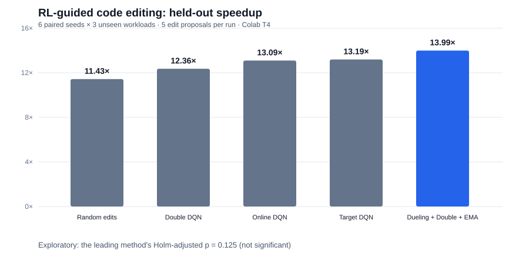

# CodeLab RSI — RL-Governed Program Improvement

**A reproducible Colab T4 experiment in learning how to select successive executable code edits.**

[Run in Google Colab](https://colab.research.google.com/github/Vedant2100/vedant2100.github.io/blob/master/projects/rl-recursive-code-optimizer/RSI_CodeLab_Colab.ipynb) · [Notebook source](./RSI_CodeLab_Colab.ipynb) · [Full experimental report](./results/report.json) · [Technical blog](https://vedant2100.github.io/posts/rl-codelab-rsi/)

## Scientific question

Do DQN target networks, Double DQN, or dueling+Double DQN with an exponential-moving-average target help a controller choose sequential code-optimization edits that **actually pass correctness tests and run faster on unseen input shapes**?

## What really executes

- **Workload:** exact Euclidean k-nearest-neighbor indices on deterministic generated arrays.
- **Code space:** distance computation by broadcast subtraction, GEMM identity, or chunked GEMM; `argsort` vs `argpartition`; float32 or float64; two chunk sizes (24 finite combinations; some chunk choices are semantically identical for non-chunked kernels).
- **Correctness:** candidate output must match independent double-precision brute-force neighbors; fail closed on exceptions or mismatched indices.
- **Feedback:** real CPU NumPy latency measured three times and cached by program/workload before training. A controller proposes an edit, receives log latency improvement, accepts faster edits and rejects slower ones; transitions form a five-step code-edit trajectory.
- **Learned controller:** PyTorch DQN trained on Colab's Tesla T4 with a replay buffer. The **CPU** runs the algorithm benchmarks; the **GPU** trains neural controllers.
- **Generalization:** train using four calibration input shapes and freeze weights before testing on three distinct held-out shapes. No held-out feedback is used to fit the models.
- **Fairness:** every controller receives the same five proposed edits at test time. Baseline random receives the same budget.

## Reproduction

Open [RSI_CodeLab_Colab.ipynb](./RSI_CodeLab_Colab.ipynb) in Colab, set *Runtime → Change runtime type → T4*, then **Runtime → Run all**. Requires Colab packages `numpy`, `scipy`, `pandas`, `matplotlib`, and `torch`. All 6 code cells completed on a Tesla T4 in the connected Colab run (44 seconds). Rerun measurements may vary with hardware, CPU BLAS, load, and library versions.

## Verified experiment (October 21, 2026)

96/96 training-program checks and 72/72 held-out-program checks passed; 90 held-out policy outcomes from 6 random seeds, 3 held-out workloads, and 5 methods. Each network trained for 75 five-step episodes per seed.

| Method | Geometric held-out speedup from naive code | Paired Wilcoxon p vs random (Holm-adjusted) |
| --- | ---: | ---: |
| Random edits | 10.224× | — |
| Online-only DQN | 12.377× | 0.2500 |
| DQN with hard target | 12.258× | 0.2500 |
| Double DQN with hard target | 12.205× | 0.2500 |
| Dueling Double DQN with soft target | 12.018× | 0.2500 |

**Interpretation:** The highest geometric held-out speedup in this repeat was from online-only DQN, not the dueling/Double/soft-update system, and **none of the four RL comparisons to random is significant after correction**. This experiment cannot identify which component causes any observed difference because the combined arm changes more than one factor. The very large absolute speedup mainly reflects replacing a deliberately inefficient broadcast implementation with a faster kernel family; it is not evidence of a new algorithm exceeding optimized libraries.

## Results and claims

- `results/codelab_calibration.csv` — real executable calibration configurations, timings, correctness.
- `results/codelab_heldout_measurements.csv` — held-out implementation correctness/timing.
- `results/codelab_heldout_results.csv` — every held-out seed, method, final code configuration, and reward.
- `results/report.json` — exact aggregated outcomes and multiple-comparison adjustment.
- The notebook itself generates `/content/codelab_heldout.png` and `/content/codelab_learning_curves.png` during Colab execution.

## Boundaries

This is **not** an LLM autonomously rewriting its code, a reproduction of Recursive's Eureka Machine, or evidence for full recursive model self-improvement. The source-code edit family is hand-authored and finite; exhaustive calibration/profiling is possible; agents learn to select edits through cached benchmark feedback; no direct interaction with SWE-bench or frontier model training is claimed. Six seeds are underpowered, and runtime timing is noisy. More work is required to isolate target-update effects, train on genuinely unseen code tasks, and assess evaluator overfitting.

## Research inspiration

DQN ([Mnih et al.](https://arxiv.org/abs/1312.5602)); Double DQN ([van Hasselt et al.](https://arxiv.org/abs/1509.06461)); Dueling DQN ([Wang et al.](https://arxiv.org/abs/1511.06581)); Darwin Gödel Machine ([Zhang et al.](https://arxiv.org/abs/2505.22954)); RRSI ([Xia et al.](https://arxiv.org/abs/2609.24972)).

License: experiment text and code offered for review and reproduction; no claim of scientific novelty.
